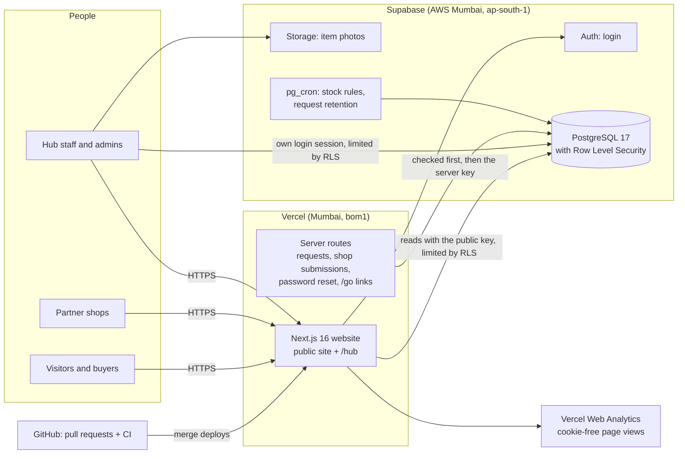
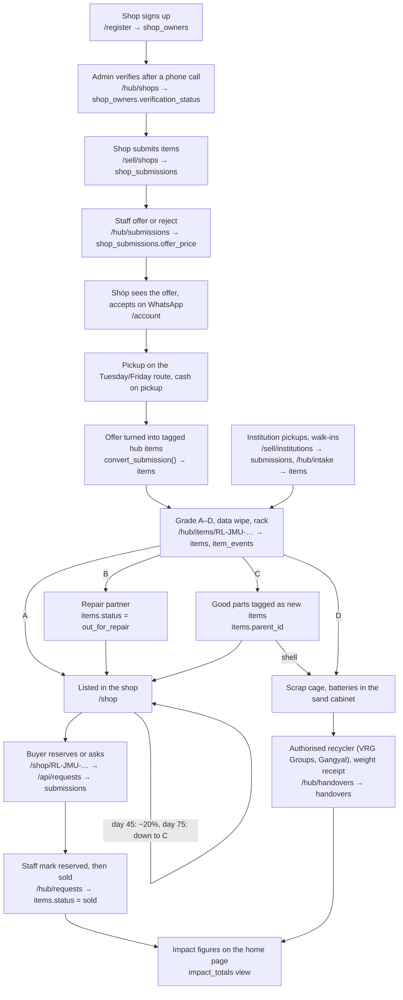

# The ReLoop platform

This section describes the software behind ReLoop: what it is built on, how an item moves through it, who can see what, how the dashboard figures are worked out, how fast the site is, and what is still missing. Status is as of 14 October 2026, before the pilot starts in November 2026.

## 1. Architecture

ReLoop is one website with two halves: the **public site** (shop, sell-to-us pages, guides) and the **staff hub** (`/hub`), where the team logs, grades and sells stock. Both run on the same two services.

- **Next.js on Vercel.** The website is built with Next.js 16 and hosted on Vercel. Its server code runs in Vercel's Mumbai region (`bom1`), close to the database. Every change goes through a GitHub pull request. Automatic checks (lint, types, unit tests, build and browser tests) must pass before it is merged, and merging deploys it to production.
- **Supabase.** One Supabase project in AWS Mumbai (`ap-south-1`) provides three things:
  - the **database** (PostgreSQL 17);
  - **login** (Supabase Auth: email and password);
  - **storage** for item photos.
- **Row Level Security (RLS).** The browser talks to the database directly, but every table has rules that decide row by row and column by column who may read or change it. Anything sensitive (saving a public request, a shop submission, a password reset, counting a link click) goes through a server route instead, which checks the request before it uses the privileged server key. That key never reaches the browser.
- **Scheduled jobs** run inside the database with `pg_cron`:
  - the unsold-stock price rules, daily at 06:00 IST;
  - the deletion of old closed requests, daily at 03:30 IST.

## 2. The circular loop

The business plan's loop is: collect from shops and institutions → grade at one hub → resell, repair or strip for parts → only the truly dead goes to the authorised recycler. Each step has a page and a database table.

### Final loop audit

Every link in the loop was tested on the live system with temporary test accounts. All test data was removed afterwards, or the test ran inside a transaction that was rolled back.

| Step                               | Where                                   | Table / function                                                     | Status                                            | Evidence                                             |
| ---------------------------------- | --------------------------------------- | -------------------------------------------------------------------- | ------------------------------------------------- | ---------------------------------------------------- |
| Shop signs up                      | `/register`                             | `auth.users`, `profiles`, `shop_owners`                              | Works                                             | Live sign-up tests with temporary accounts           |
| Admin verifies the shop            | `/hub/shops`                            | `shop_owners.verification_status` (trigger blocks self-verification) | Works                                             | PR #19; live check                                   |
| Shop submits items (verified only) | `/sell/shops` → `/api/shop-submissions` | `shop_submissions`                                                   | Works                                             | Live test 18/18 (PR #28)                             |
| Staff offer or reject              | `/hub/submissions`                      | `shop_submissions.offer_price`, `offer_note`                         | Works                                             | Same test; bug fixed in PR #29                       |
| Shop sees the offer                | `/account`                              | own `shop_submissions` rows only                                     | Works                                             | Same test                                            |
| Shop accepts                       | WhatsApp (by design)                    | —                                                                    | Off-platform                                      | —                                                    |
| Offer becomes hub items            | `/hub/submissions`                      | `convert_submission()` → `items.shop_submission_id`                  | Works, refuses a second run                       | Same test                                            |
| Other intake                       | `/hub/intake`                           | `items` (tag counter)                                                | Works                                             | Live hub test (PR #25)                               |
| Grade, wipe, repair, strip         | `/hub/items/RL-JMU-…`                   | `items`, `item_events`                                               | Works                                             | Live hub test                                        |
| Listing and price rules            | `/shop`; daily job                      | `items.status = listed`; `apply_stock_rules()`                       | Works, runs once per item                         | Live hub test; PGlite tests                          |
| Buyer reserves or asks             | `/shop/RL-JMU-…` → `/api/requests`      | `submissions`                                                        | Works; only listed or reserved items              | Live test (PR #28)                                   |
| Staff mark reserved or sold        | `/hub/requests`                         | `items`, `submissions`                                               | Works                                             | Same test                                            |
| Institution pickup booking         | `/sell/institutions` → `/api/requests`  | `submissions`                                                        | Works                                             | Same test                                            |
| Recycler handover                  | `/hub/handovers`                        | `handovers`                                                          | Works                                             | Live hub test; impact test (rolled back)             |
| Old requests deleted               | daily job                               | `purge_closed_requests()`                                            | Works                                             | Live test 5/5 (rolled back, PR #34)                  |
| Impact on the home page            | `/`                                     | `impact_totals` view                                                 | Works; shows "Pilot starts November 2026" at zero | Live test (rolled back, PR #37)                      |
| Outreach clicks                    | `/go/<link>`                            | `link_visits`                                                        | Works                                             | 5 links counted once each, previews skipped (PR #35) |
| Partner map                        | `/locations`                            | `map_partner_shops` view                                             | Works; needs recorded consent                     | Live test 5/5 (PR #30)                               |

### Business Plan v2 additions

- **Scrap by weight.** Counter weigh-ins at the public rate card feed a kilo ledger with five bins (screens, boards, batteries, other, D devices). Each bin is handed over to VRRG Group on its own receipt. Receipts have a private link (`/receipt/<token>`, kept out of search engines).
- **Parts Exchange.** Partner shops list tested parts; staff receive, test and approve them; ReLoop sells them and keeps a 12% commission; buyers have a 7-day return window. Tested parts carry no grade.
- **Institution lots.** A flat lot fee per institution lot, with equipment itemised on the receipt.
- **Stock rules.** Listed parts are cut by 25% once on day 30; A and B devices that have not sold by day 45 move to grade C for stripping.
- **Ownership and wipe.** Intake records the seller's ownership tick; a device must be wiped before it is stripped. The date from which both are enforced is a staff setting (empty until launch).
- **Money stays private.** Targets, costs and margins are staff-only settings (`finance.*`, `vrg.*`) and are not in the repository or on the public site.

### v1.0.0 additions (batches 16 to 26)

- **Impact and network.** `impact_flows` and `network_flows` give source-to-outcome and market-to-hub-to-buyer-area flows in kg and items. Markets with fewer than three active shops merge into "Other Jammu markets"; a buyer area appears only from three items. `/impact` draws them as server-rendered Sankey diagrams; `/network` on a map.
- **Operations.** The route run sheet (`route_sheet()`), the repair board (`return_repair_job()`), capacity (`capacity_status()`: bins, the weekly battery cabinet, device racks, the parts shelf, stock ages) and the institution handover record.
- **Staff pricing.** `item_margins` runs as the caller, so only staff see rows; COGS is buy plus repairs plus handling; flags use only the plan's unit figures from staff-only settings.
- **Partners and transparency.** A consent-based partner directory with kg in bands, the shop's own dashboard, the public handover ledger, monthly reports with PDF and CSV, open data with a dictionary and an activity feed that stays empty until there are five events in 30 days and never shows anything under a day old.
- **Standards.** Grading, data wipe (with a live count), rate card, ownership, compliance, about, FAQ and accessibility pages.

## 3. Security

### Who can see what

| Role                        | Can see and do                                                                                                                                                                                 | Can't see or do                                                                                                                          |
| --------------------------- | ---------------------------------------------------------------------------------------------------------------------------------------------------------------------------------------------- | ---------------------------------------------------------------------------------------------------------------------------------------- |
| **Visitor** (not logged in) | Public pages; listed items (shop-facing details only); the partner map (name, market, position); the three impact totals; send a reservation, question or institution booking through the site | Anyone's requests or contact details; purchase prices, suppliers or internal notes; shops, partners, handovers; insert anything directly |
| **Buyer** (logged in)       | The same, plus their own profile                                                                                                                                                               | Other people's requests (they get an empty list), all hub data                                                                           |
| **Shop owner**              | Their own shop record and verification status; their own submissions with ReLoop's offer and note; submit items **once verified**                                                              | Other shops; ReLoop's internal notes; changing their own verification (blocked twice: by RLS and by a trigger)                           |
| **Hub staff**               | All hub stock, including costs; shops and institutions; handovers; public requests with contact details; shop submissions; make offers; turn offers into items                                 | Shop verification, password resets, the team, the map, the audit log, link counts                                                        |
| **Admin**                   | Everything staff can, plus verify shops, reset passwords (after an identity check), manage the team, put consenting shops on the map, read the audit log and tracked-link counts               | The passwords themselves: resets are logged without them. Removing the last admin is blocked.                                            |

Other protections:

- A temporary password gives no staff or admin rights until the person sets their own.
- Requests are deleted automatically 12 months after they are closed.
- Tracked-link clicks store no personal data.
- The site sends no email, by decision. Account recovery is done by an admin after a phone check.

### The 2026-10-14 security fixes

A review of the live database on 13 October 2026 found that the hand-made tables were too open. One SQL fix script, backed up and applied in a single transaction, closed every hole SQL can fix.

| #   | Severity | Before                                                                              | After                                                                   |
| --- | -------- | ----------------------------------------------------------------------------------- | ----------------------------------------------------------------------- |
| 1   | High     | Anyone could read listings' purchase cost, processing cost and internal notes       | Visitors can read only shop-facing columns                              |
| 2   | Medium   | Unverified shop owners could insert submissions directly, with any status or price  | Submissions go only through the server route, which checks verification |
| 3   | Medium   | Anyone could create orders and enquiries with any status, amount or contact details | Direct inserts removed                                                  |
| 4   | Medium   | Email confirmation off                                                              | **Still open** (needs an email sender; email is off by decision)        |
| 5   | Medium   | Preview deployments use the production database                                     | **Still open** (needs a separate test project)                          |
| 6   | Low      | Only RLS stopped shop owners changing their own verification                        | A guard trigger blocks it as well                                       |
| 7   | Low      | Unneeded write grants on listings and categories                                    | Removed                                                                 |
| 8   | Low      | The public image bucket had no size or file-type limit                              | Limits set                                                              |
| 9   | Low      | Some security-definer functions were executable by visitors                         | Execution revoked                                                       |
| 10  | Low      | Shop owners could read ReLoop's internal notes on their own submissions             | Column hidden from them                                                 |
| 11  | —        | The hub's tables didn't exist live                                                  | Created                                                                 |

### Live checks

Two read-only SQL files check the live database's permissions and are re-run after every change:

- `supabase-fixes/2026-10-14-checks.sql`: 13 checks;
- `supabase-fixes/live-checks-extra.sql`: 30 checks;
- `supabase-fixes/live-checks-v1.sql`: 19 checks (batches 01 to 15);
- `supabase-fixes/live-checks-v2.sql`: 11 checks (Business Plan v2);
- `supabase-fixes/live-checks-v3.sql`: 8 checks (batches 16 to 25).

The v1.0.0 checks (19 + 11 + 8) pass on the repo schema in the in-memory tests; they are run on production after the release migrations (`scripts/finish-v1-local.md`).

**All 43 were true after the last change of round 4 (14 October 2026).** They prove, among other things, that:

- visitors and buyers can't read anyone's contact details, requests, costs, shops, partners or handovers;
- shop owners can't read internal notes or verify themselves;
- only admins can reset passwords, change roles or read link counts;
- the public views (map, impact totals) expose only their listed columns;
- ReLoop has at least one admin;
- both daily jobs are scheduled.

Besides the live checks, 254 database tests replay every query the site makes in an in-memory copy of the database (PGlite), 244 unit tests cover the site's logic, and about 390 browser tests (desktop and phone) run on every pull request.

## 4. KPI definitions

These are exactly what the KPI page (`/hub/kpis`) computes, in `frontend/src/features/inventory/stats.ts`. Months are calendar months.

**Stock** (`dashboardStats`):

| KPI                    | Definition                                                                                                       |
| ---------------------- | ---------------------------------------------------------------------------------------------------------------- |
| Items in (per month)   | Hub items received that month, by received date. Parts stripped from a C item are not counted again.             |
| Graded                 | Of those, items with a grade.                                                                                    |
| Grade mix              | Count of A, B, C and D among graded items.                                                                       |
| Reused (A + B + C)     | (A + B + C) ÷ graded items for the month. Shown blank when nothing is graded.                                    |
| Sold (per month)       | Items with a sold date in that month (parts included).                                                           |
| Scrap handed over (kg) | Sum, over handovers dated that month, of the kilograms in every category plus battery kilograms.                 |
| On racks               | Items in the hub not yet sold or recycled: received, graded, out for repair, being stripped, listed or reserved. |
| Average stock age      | Mean days since received, over items on racks. Blank when there are none.                                        |
| Active partner shops   | Partner shops whose status is "active".                                                                          |

**The rest of the loop** (`loopStats`):

| KPI                                          | Definition                                                        |
| -------------------------------------------- | ----------------------------------------------------------------- |
| Reservations, Questions, Institution pickups | Public requests of each kind, by the month they arrived.          |
| Shop submissions in                          | Shop submissions by the month they were sent.                     |
| Offers made                                  | Submissions with an offer price, by the month they were reviewed. |
| Bought from shops                            | Submissions turned into hub items, by purchase month.             |
| Paid to shops                                | Sum of the purchase price of those submissions.                   |

**Public impact counter** (home page, `impact_totals` view, all time):

| Figure                    | Definition                                                          |
| ------------------------- | ------------------------------------------------------------------- |
| Items reused              | Hub items graded A, B or C, excluding parts stripped from a C item. |
| kg handed to the recycler | All handover kilograms (every category) plus battery kilograms.     |
| Active partner shops      | Partner shops with status "active".                                 |

Until any of the three is above zero, the home page shows "Pilot starts November 2026" instead. Sample listings can never be counted: they live in a separate table.

## 5. Speed (Lighthouse)

Mobile Lighthouse scores, on a local production build, before and after the round-3 quality pass:

| Page               | Performance | Other changes                                                |
| ------------------ | ----------- | ------------------------------------------------------------ |
| Home               | 85 → 90     | —                                                            |
| `/shop`            | 87          | Accessibility 98 → 100, best practices 96 → 100              |
| Item page          | 92          | —                                                            |
| `/locations` (map) | 83 → 96     | Best practices 96 → 100; largest content shown 4.8 s → 2.8 s |
| `/sell/shops`      | 96          | —                                                            |
| `/hub`             | 95          | —                                                            |

- Accessibility and best practices are 100 on all six pages.
- `/hub` scores 63 for SEO on purpose: it is hidden from search engines.
- On production, the home page scored 93 and `/locations` 91–92. A very first, uncached load of `/locations` scored 78.

## 6. Known limitations

The full list is in [`docs/known-limitations.md`](../known-limitations.md). The main ones:

- **Before launch:**
  - the "early preview" and sample listings must go;
  - the privacy policy and terms need legal review;
  - the hub's exact address is still to come;
  - ReLoop doesn't yet hold its own JKPCC consent or CPCB refurbisher registration (planned from month 6), so the site claims only to use an authorised recycler.
- **Accounts:**
  - email confirmation is off and no email is sent, so password recovery depends on an admin;
  - the team still shares one admin login until each person gets their own.
- **Security:**
  - no rate limiting on the public forms;
  - preview deployments share the production database;
  - the browser tests can't run against a real database until a separate test project exists.
- **Operations:**
  - backups are manual (no point-in-time recovery on the current plan);
  - the printed QR codes depend on the current web address staying assigned.
- **Analytics:** Vercel's free plan doesn't break visits down by campaign, so ReLoop counts its own short-link clicks.
- **Not built:** label printing, offline use, more than one hub.

## 7. Pull requests

Every change since the production health check, one line each. All were merged after the automatic checks passed, except #24, which was closed.

| PR  | Change                                                                                    |
| --- | ----------------------------------------------------------------------------------------- |
| #15 | Production health check: lint fixes, contact details and docs                             |
| #16 | Record of the database fix being applied                                                  |
| #17 | Admin account role, an admin tidy-up script, and the business plan added to the repo      |
| #18 | Sample listings labelled "not for sale"; account cleanup                                  |
| #19 | Admin page to verify or reject shop owners                                                |
| #20 | Forgot-password, reset and resend-confirmation pages                                      |
| #21 | Locations map, printable QR code and the tracked drive link                               |
| #22 | Contact details, grievance officer and a consistency pass                                 |
| #23 | Known-limitations document                                                                |
| #24 | Closed: opened from the wrong branch, replaced by #25                                     |
| #25 | Staff hub moved onto the shared database; KPI exports; stock rules that run once per item |
| #26 | Progress wrap-up and what's left for the team                                             |
| #27 | Admin password reset with a forced password change                                        |
| #28 | Closing the loop: offers, turning submissions into hub items, saved public requests       |
| #29 | Fix: saving an offer or request status failed in production                               |
| #30 | Verified partner shops on the public map, with recorded consent                           |
| #31 | Team page: promote and demote staff and admins, always one admin                          |
| #32 | Quality: readable small text, heading order, faster map                                   |
| #33 | Round-3 documentation                                                                     |
| #34 | Closed requests deleted automatically 12 months after closing                             |
| #35 | Tracked short links for Instagram, WhatsApp and the QR code                               |
| #36 | "What we accept" page and WhatsApp chat buttons                                           |
| #37 | Home-page impact counter from a totals-only public view                                   |
| #38 | Printable partner-shop poster and awareness-drive flyer                                   |
| #39 | Bilingual help page and shop owner guide for partner shops                                |
| #40 | This report material, the staff guide and the round-4 wrap-up                             |
